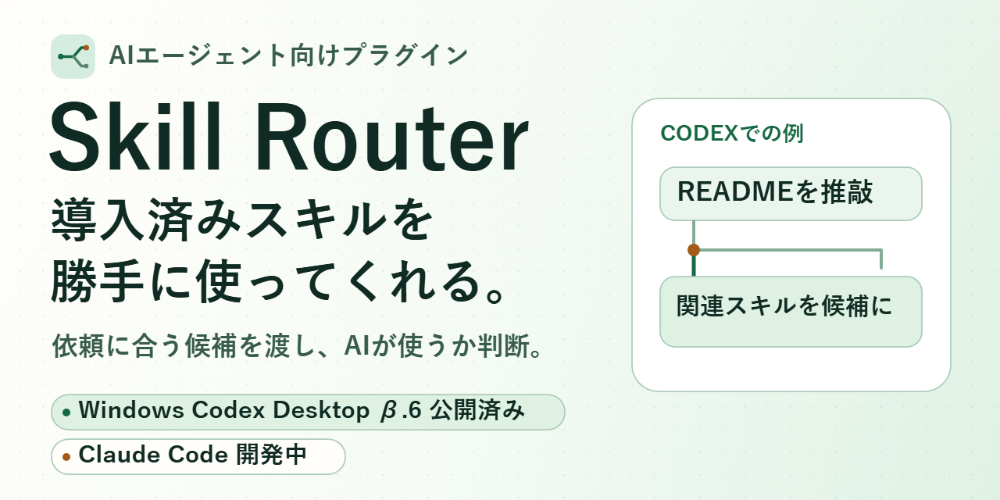

# Skill Router

**導入済みスキルを勝手に使ってくれる。**

Skill Routerは、依頼に合うガイドや導入済みスキルの参照先を自動で渡すAIエージェント向けプラグインです。普段どおりに頼めば、スキル名を毎回指定する必要はありません。



[β.6をダウンロード](https://github.com/AMZ-jpcslr/skill-router/releases/tag/v0.1.0-beta.6) · [紹介動画（19秒・MP4）](assets/skill-router-demo-light.mp4)

- **Codex Desktop（Windows）**：β.6公開済み。
- **Claude Code**：開発中。実機での動作は未確認です。公開済みのβ.6 ZIPには含まれません。

| 依頼の例 | 渡すもの |
| --- | --- |
| READMEの説明文を自然な日本語に書き直して | README用ガイド。日本語の推敲に合うスキルが導入済みなら、その候補も |
| READMEにこの一文だけ足して | 文面が指定済みなら、推敲用の候補は渡さない |
| 短い紹介動画を作って | 動画制作に合う導入済みスキルが見つかれば、その参照先 |
| 動画の作り方だけ教えて | 動画制作の候補は渡さない |

候補が届いても、AIが必ず使うわけではありません。別の手段で作業することもあります。採用したか、参考にしただけかを知りたいときは、依頼の末尾に「スキル判断を表示」と1行加えてください。

## Codex Desktopで試す（Windows）

**必要なもの：** Codex Desktop、プラグイン管理に対応したCodex CLI、PATH上のPython 3.10以上。

1. [Releases](https://github.com/AMZ-jpcslr/skill-router/releases)から配布ZIPを取得し、展開します。展開先はインストール後も残してください。
2. 展開先をPowerShellで開き、次の2行を実行します。コマンドが見つからない場合は[Codex CLIの導入手順](https://developers.openai.com/codex/cli)を確認してください。

   ```powershell
   codex plugin marketplace add .
   codex plugin add skill-router@skill-router-preview
   ```

3. Codex Desktopで試したいフォルダを開き、新規チャットを始めます。**Review hooks** が表示されたら `UserPromptSubmit` の内容を確認し、自動選択を使う場合は承認します。
4. **Skill Router 設定**（`$skill-router-settings`）を選び、「この作業フォルダだけ自動選択をオンにして、導入済みスキルの索引を更新して」と送ります。
5. 「READMEの説明文を初めて読む人にも自然な日本語に直して」など、普段の言葉で依頼します。

配布版β.6はWindowsの2台で、Codex Desktopへのガイドや候補の引き渡しまで確認しました。フォルダなしのチャットへの引き渡しはDesktopで未確認です。

## 自動選択の範囲

初期状態では自動選択はオフです。フォルダ単位でオンにした場合、親・子・兄弟フォルダを別の作業場所として開くと引き継がれません。

Codex版は設定スキルから「全プロジェクト」「フォルダなしのチャット」も別々にオンにできます。「全プロジェクト」がオンの間は、個別登録を外しても動作します。「全部オフ」で自動選択を停止し、個別登録も解除できます。旧試作フックとの併用は避けてください。

## スキルのおすすめと索引

Codexで自動選択を使わず、候補だけを聞く場合は **Skill Suggest**（`$skill-suggest`）を使用します。導入済みスキルや公開候補を案内し、自動インストールはしません。[単体版](standalone/skill-suggest/)はフック不要です。

- README編集、原因調査、回帰テスト、応募文、Wordの変更履歴には短いガイドを同梱しています。
- 導入済みスキルは各PCで索引を作ります。`~/.agents/skills` と `~/.codex/skills` が既定の検索先です。スキルの追加・変更後は索引を更新してください。
- 索引に保存する主な情報はスキル名・説明・ファイルの場所です。索引と設定は `~/.skill-router-beta/` に保存します。おすすめ用の作業分類の履歴は、明示的に記録を頼まれた場合にだけ残します。

フック自体は依頼文を保存せず、外部通信や候補スキルの実行も行いません。候補を読む場合も、各サービスの通常の権限が適用されます。[Nihongo](https://github.com/AnIT012/nihongo)などの外部スキルは同梱していません。

[MITライセンス](LICENSE) ・ [変更履歴](CHANGELOG.md) ・ [Codexの同梱フックのレビュー](https://learn.chatgpt.com/docs/hooks#plugin-bundled-hooks)
