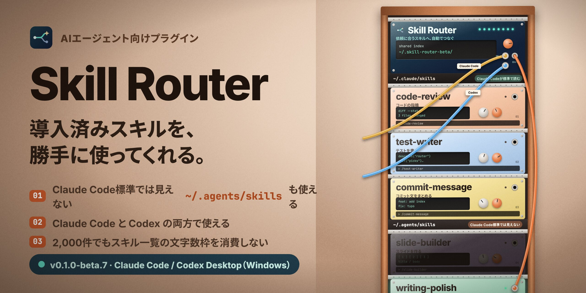

# Skill Omakase

**導入済みスキルを勝手に使ってくれる。**

Skill Omakaseは、依頼に合うスキルの参照先と作業ガイドを自動で渡す、AIエージェント向けプラグインです。



- **標準では見えないスキルも使える**：Claude Codeが自分では読まない `~/.agents/skills` などのスキルからも、依頼に合うものを渡します。
- **Claude CodeとCodexの両方で使える**：同じプラグインを両方に導入でき、設定と索引も共通です。
- **2,000件規模でもスキル一覧の文字数枠を消費しない**：スキル一覧をまとめて渡さず、依頼ごとに合う候補だけを渡します。

### 実測：150件のスキルから正しい1件を選べるか

公開されているスキル選択の比較試験（[agentic-skill-router](https://github.com/legendtkl/agentic-skill-router) の `experiments/dci-compare`、SkillsBench由来）で測りました。150件のうち正解は19件で、残りは紛らわしい類似スキル80件と無関係なスキル51件です。スキル名は `skill-NNN` に伏せてあり、名前では当てられません。24問を各3回、Claude Code（opus）で実行しています。時間は3回それぞれの中央値の幅です。

| 条件 | 正解率 | 1問の時間（中央値） |
| --- | --- | --- |
| Skill Omakase（`~/.claude/skills` に150件） | **95.8%** | 6.6〜7.1秒 |
| Skill Omakase（`~/.agents/skills` に150件） | 94.4% | 5.3〜5.7秒 |
| Claude Code標準（`~/.claude/skills` に150件） | 75.0% | 5.3秒 |
| Claude Code標準（`~/.agents/skills` に150件） | 使えない（読み込みの対象外） | ― |
| agentic-skill-router 0.1.7 | 98.6% | 14.6秒 |

標準のスキル一覧を使わないまま標準より多く正解し、検索を何往復もするルーターの半分以下の時間で答えます。`~/.agents/skills` に置いたスキルは標準では使われませんが、Skill Omakaseなら同じように選べます。測定はSkill Omakase β.10（6b4a046）で2026年11月28日、標準とagentic-skill-routerは11月27日です。

**β.9：Claude Code・Codex Desktop（Windows）**

[β.9のリリースページ](https://github.com/AMZ-jpcslr/skill-router/releases/tag/v0.1.0-beta.9) · [紹介動画（19秒・音あり・MP4）](https://github.com/AMZ-jpcslr/skill-router/blob/main/assets/skill-omakase-demo.mp4)

## 1. 導入する

PATHに登録したPython 3.10以上が必要です。PowerShellで `python --version` を実行すると、バージョンを確認できます。`python3` が使えない環境（WindowsのMicrosoft Storeの代替コマンドなど）では `python` を使います。

### Claude Code

1. Claude Codeのコマンド（`claude`）がまだ使えない場合は、PowerShellで導入します。

   ```powershell
   irm https://claude.ai/install.ps1 | iex
   ```

   導入先の `%USERPROFILE%\.local\bin` がPATHにないと、`claude` が見つかりません。次の1行でPATHに加え、PowerShellを開き直します。

   ```powershell
   [Environment]::SetEnvironmentVariable("Path", [Environment]::GetEnvironmentVariable("Path", "User") + ";$env:USERPROFILE\.local\bin", "User")
   ```

2. Claude Codeのチャットで、次の2行を実行します。

   ```text
   /plugin marketplace add AMZ-jpcslr/skill-router
   /plugin install skill-omakase@skill-omakase-preview
   ```

設定は `/skill-omakase:skill-omakase-settings`、おすすめは `/skill-omakase:skill-suggest`（または「おすすめのスキルを教えて」）で呼び出します。Claudeデスクトップアプリでは「Code」タブのローカルセッションで使えます。Coworkは `~/.claude` のプラグインを読まないため、別途「カスタマイズ > プラグイン > マーケットプレイスを追加」で `AMZ-jpcslr/skill-router` を追加します。`~/.claude/skills` も索引の対象です。

### Codex Desktop

1. [プラグイン管理に対応したCodex CLI](https://developers.openai.com/codex/cli)がまだない場合は、Node.jsを入れたうえで導入します。

   ```powershell
   npm install -g @openai/codex
   ```

2. [リリースページ](https://github.com/AMZ-jpcslr/skill-router/releases/tag/v0.1.0-beta.9)から配布ZIPを取得し、展開します。
3. 展開したフォルダをPowerShellで開き、次を実行します。以前の版を入れていた場合は、先に1行目で古い配布元を外します（β.9まではSkill Routerという名前で、配布元は `skill-router-preview` です）。

   ```powershell
   codex plugin marketplace remove skill-router-preview
   codex plugin marketplace add .
   codex plugin add skill-omakase@skill-omakase-preview
   ```

展開先はプラグインの配布元として使うため、導入後も残しておきます。導入後はCodex Desktopを再起動します。

### Skill Routerから乗り換える（β.9までを入れていた場合）

β.10でプラグインの名前をSkill RouterからSkill Omakaseに変えました。古いプラグインを外してから、上の手順で入れ直します。

- Claude Code：次の2行で古いものを外してから、上の2行を実行します。

  ```text
  /plugin uninstall skill-router@skill-router-preview
  /plugin marketplace remove skill-router-preview
  ```

- Codex Desktop：上の手順3の1行目（`codex plugin marketplace remove skill-router-preview`）で外れます。

設定・索引・検索語・記録はそのまま引き継がれます。新しい版を最初に使ったときに `~/.skill-router-beta/` が `~/.skill-omakase/` に移ります。`SKILL_ROUTER_` で始まる環境変数も、そのまま読みます。

### 検索語を作る（初回に1回）

日本語の依頼でも合うスキルを見つけやすくするため、スキルごとの検索語をClaude（haiku）で作ります。送るのはスキル名と説明の一部だけで、依頼の内容は送りません。数分かかり、少し利用料がかかります。Claude Codeのコマンド（`claude`）が必要です。

```powershell
$r = (Get-ChildItem "$env:USERPROFILE\.claude\plugins", "$env:USERPROFILE\.codex\plugins" -Recurse -Filter router.py -ErrorAction SilentlyContinue | Where-Object FullName -like "*skill-omakase-settings*" | Sort-Object LastWriteTime -Descending | Select-Object -First 1).FullName
python $r index refresh --keywords
```

設定・索引・検索語はClaude CodeとCodexで共通（`~/.skill-omakase/`）なので、1回で両方に効きます。この操作は初回だけです。以降はスキルを追加・変更・削除しても、プラグインを更新しても、次の依頼のときに索引が自動で追従し、新しいスキルの検索語も裏で作られます。

## 2. 初回セットアップ

1. Codex Desktopで使いたい作業フォルダを開き、新規チャットを始めます。
2. **Review hooks** が表示されたら、[同梱フック](https://learn.chatgpt.com/docs/hooks#plugin-bundled-hooks)の `UserPromptSubmit` の内容を確認し、使う場合は承認します。
3. **Skill Omakase 設定**（`$skill-omakase-settings`）を選び、次のように頼みます。

   > この作業フォルダだけ自動選択をオンにして。

## 3. 使ってみる

スキル名を指定せず、作業を頼みます。まずは次の依頼で試せます。

> READMEの説明文を初めて読む人にも自然な日本語に直して。

Skill OmakaseはREADME用のガイドを渡し、導入済みスキルに推敲向けの候補があれば参照先を添えます。どの候補を使うかはAIエージェントが作業内容に合わせて判断します。

返答の最後には、実際に使ったスキルが1行で出ます（例：`Skill Omakase: nihongo-polish、readme（ガイド）`、使わなかったときは `Skill Omakase: 該当なし`）。この行は編集したファイルや作った文章には入らず、「本文だけ」と頼んだときは出ません。採用・参考・見送りの内訳まで見たいときは、依頼の末尾に「スキル判断を表示」と1行追加します。

## 4. 設定を変える

設定は **Skill Omakase 設定**（`$skill-omakase-settings`）で変更します。初期状態はオフです。

| 頼み方 | 設定 |
| --- | --- |
| この作業フォルダだけオン／オフ | 開いているフォルダを個別に設定。親・子・兄弟フォルダは別の作業場所として扱います |
| 全プロジェクトをオン／オフ | フォルダを開いているチャット全体を設定。オンの間は個別設定より優先します |
| フォルダなしのチャットをオン／オフ | フォルダなしと判定したチャットを設定 |
| 状態を教えて／全部オフ | 現在の設定を表示／すべての自動選択をオフにして個別登録を解除 |
| 索引を更新して | 導入済みスキルの追加・変更・削除をすぐ反映（通常は次の依頼で自動反映） |
| 使ったスキルの表示をオフ／オン | 返答の最後の `Skill Omakase:` の1行を出さない／出す（初期状態はオン） |

## 5. 機能

- **自動選択**：依頼の目的と作業内容に合う候補を探します。例えば、動画制作と既存動画からの文字抽出は別の作業として扱います。手順を聞いただけなら説明が中心になり、制作向け候補の追加は見送ります。
- **内蔵ガイド**：README編集、原因調査、回帰テスト、応募文、Wordの変更履歴に短い作業ガイドが付属します。
- **スキルのおすすめ**：**Skill Suggest**（Claude Codeは `/skill-omakase:skill-suggest`、Codexは `$skill-suggest`）を呼び出すか、「おすすめのスキルを教えて」と頼むと、普段の依頼の傾向から、スキル設定の見直し（毎回名前で呼んでいるスキルの説明に足す語、使われていないスキル、重複、Claude Codeの一覧枠を圧迫しているスキルの移し先）と、合うスキルがない作業に向く公開スキルを提案します。「〜に使えるスキルは？」と聞けば、その作業に合う導入済み・公開スキルを探します。配布元の分類から分野ごとに見ることもでき、同梱の一覧で見つからないときは Find-skills（skills.sh）での検索を案内します。
- **スキルの健康診断**：Skill Suggestに「スキルを診断して」と頼むと、説明が短い・あいまいで選ばれにくいスキルと、役割が重なって見分けにくいスキルの組を挙げ、使い分けがはっきりする説明の直し案を出します。案はルーターと同じ採点で効果を確かめてから示し、SKILL.mdは書き換えません（コマンドは `router.py doctor`、1件だけなら `--skill <名前>`）。
- **ローカル索引**：`~/.agents/skills`・`~/.codex/skills`・`~/.claude/skills` から、スキル名・説明・ファイルの場所を登録します。別の保管フォルダは設定から追加できます。索引と設定の保存先は `~/.skill-omakase/` です。

おすすめの材料は、Claude CodeとCodexがもともとPCに残している依頼履歴とセッション記録（既定で直近60日）と、Skill Omakase自身の「合うスキルがなかった作業」の記録です。後者は、自動選択がオンのフォルダで、AIがどのスキルも使わずに終えた作業の依頼について、日付と内容の語（「契約書」「条項」など）だけを `~/.skill-omakase/no-fit.jsonl` に残すもので、依頼の本文は保存しません（180日で消えます）。同じ種類の作業が3日以上続くと、週に1回まで、おすすめを見られることを1行で知らせます。記録は「Skill Omakaseの記録をオフにして」（`router.py record-gaps off`）で止められ、それまでの記録も消えます。どちらもPCの外へは送りません。結果には依頼の本文を出さず、語と件数だけを使います。公開スキルは同梱の一覧（名前・説明・リンクのみ）から選び、インストールはしません。外部スキルは各配布元から入手し、各ライセンスに従って利用してください。

[MITライセンス](LICENSE) · [変更履歴](CHANGELOG.md)
