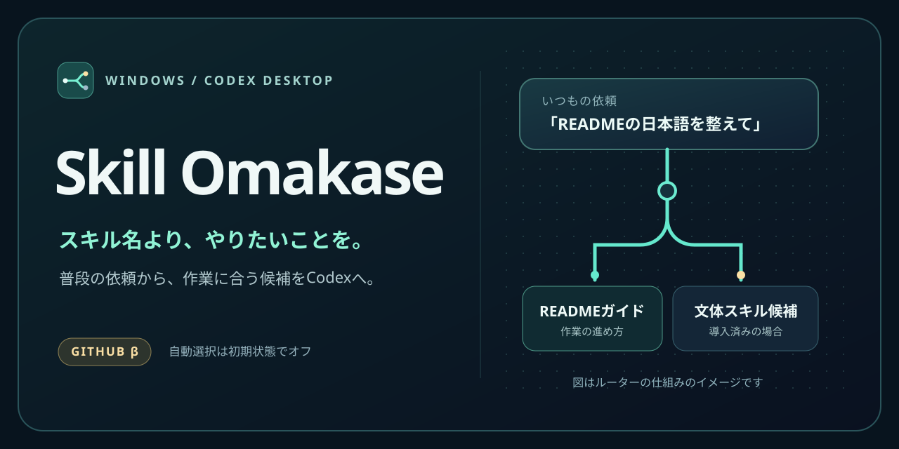

# Skill Router



Skill Routerは、作業に合うガイドやスキルをCodexに渡すWindows向けのβプラグインです。設定したフォルダでは、スキル名を毎回調べなくても、普段どおりに作業を頼めます。

たとえば「READMEの説明文を、初めて読む人にも自然な日本語に直して」と頼むと、README編集と日本語の推敲を別々の作業として扱います。README用のガイドに加え、導入済みスキルの中に推敲に合うものがあれば、その参照先も渡します。「READMEのリンク先だけ直して」なら、推敲用の候補は渡しません。

動画でも「短い紹介動画を作って」「添付動画から文字を抽出して」「作り方だけ教えて」は別の依頼として扱います。最後の例では、動画用の候補を追加しません。

## Windowsで試す

Codex Desktop、プラグイン管理コマンドが使えるCodex CLI、Python 3.10以上が必要です。PowerShellで `python --version` を実行すると、3.10以上と表示されることを確認してください。表示されない場合は、Codexを開くユーザーのPATHでPythonが使える状態にしてから進めてください。

1. GitHubの **Releases** から配布ZIPをダウンロードして展開します。展開先はプラグインの配布元として使うため、インストール後も残してください。
2. PowerShellで展開先を開き、次のコマンドを実行します。`codex` が見つからなければ、[Codex CLIの導入手順](https://developers.openai.com/codex/cli)を参照してください。

   ```powershell
   codex plugin marketplace add .
   codex plugin add skill-router@skill-router-preview
   ```

3. Codex Desktopで試したいフォルダを開き、新しいチャットを始めます。**Review hooks** が表示されたら、Skill Routerの `UserPromptSubmit` を確認します。自動選択を使う場合は、このフックを承認してください。
4. チャットで **Skill Router 設定**（`$skill-router-settings`）を選んで、次のように送ります。

   > この作業フォルダだけ自動選択をオンにして、導入済みスキルの索引を更新して。

5. 同じ作業フォルダで「READMEの説明文を更新して」のように頼みます。自動選択を試すときは、依頼にスキル名を入れなくてかまいません。スキルを追加・変更したときは、設定スキルで索引を更新してください。

## 自動選択をオンにする範囲

インストールしただけでは、自動選択は始まりません。チャットで **Skill Router 設定** を呼び出し、使いたい範囲を指定します。

| 頼み方 | 適用範囲 |
| --- | --- |
| この作業フォルダだけオン | いま開いているフォルダだけ。親・子・兄弟フォルダを別の作業場所として開いた場合には広がりません |
| 全プロジェクトをオン | 作業フォルダを開いているチャット |
| フォルダなしのチャットだけオン | 作業フォルダなしと判定したチャット。Codex Desktopでの動作は未確認です |
| 状態を教えて / 全部オフ | 設定を表示する / すべての自動選択を止めて個別登録も解除する |

「全プロジェクト」がオンなら、個別登録を外してもそのフォルダで自動選択が動きます。旧試作版のフックと併用している場合は、同じフォルダで両方を動かさないでください。プラグイン自体を外すときは、Codexのプラグイン管理から削除できます。

## スキルのおすすめだけ聞く

自動選択をオフにしたままでも、**Skill Suggest**（`$skill-suggest`）で「Wordの変更履歴に使えるスキルを教えて」と聞けます。導入済みのスキルや公開されている候補を紹介しますが、自動でインストールはしません。[単体版](standalone/skill-suggest/)にフックは不要です。

## どこまでできるか

- README編集、原因調査、回帰テスト、応募文、Wordの変更履歴には短いガイドを同梱しています。索引がなくても使えます。
- ローカル索引からは、Excel、PDF、スライド、議事録、社内報告、フロントエンド、ブラウザテスト、日本語の推敲などに合う候補を探します。候補を絞れない場合は見送ります。[nihongo](https://github.com/AnIT012/nihongo)などの外部スキルは同梱していません。
- β.2では、Windowsの2台でREADMEの依頼からガイドがCodexに届くところまで確認しました。日本語推敲や動画の言い換えの選定はローカルの選定テストで確認しました。試作フックで候補・理由の到達と見送り理由をWindowsのDesktopで確認済みです。試験用フック単独での動画制作では、候補と選定理由が重複なく届き、制作前の判断と実際に使った手順まで確認しました。配布ZIPからの新規導入は確認中です。候補が見つかっても、Codexがそのスキルを参照・実行するとは限りません。macOS、Linux、ChatGPT Work、Claude Codeでの自動選択は今回の対象外です。

## 何が選ばれ、実際に使われたか

候補があれば、Codexに候補と選定理由を渡します。Codexは作業時に採用・参考のみ・見送りを区別して伝えます。最終返答にも要約が欲しいときは、依頼文の末尾に「スキル判断を表示」を1行で足してください。依頼に厳密な出力形式がある場合は、そちらを優先します。候補が渡ることは、スキルや関連ツールが実行されたことを保証しません。

## 保存するデータ

索引に入れるのは、スキルの名前、説明、ファイルの場所です。既定の検索先は `~/.agents/skills` と `~/.codex/skills` で、必要なら設定スキルから検索先を足せます。索引と設定は各PCの `~/.skill-router-beta/` に保存します。おすすめ用の作業分類の履歴は、明示的に記録を頼んだ場合だけ残します。

フック自体は依頼文を保存せず、外部への通信やスキルの実行も行いません。候補の参照先やガイドは通常のCodexチャットの文脈に入り、Codexがスキルを読むときも通常の権限設定が適用されます。

## ライセンス

この配布物は [MITライセンス](LICENSE) です。候補として案内する外部スキルは同梱せず、各配布元のライセンスに従います。

[変更履歴](CHANGELOG.md) · [Codexのプラグイン案内](https://learn.chatgpt.com/docs/plugins) · [同梱フックのレビュー](https://learn.chatgpt.com/docs/hooks#plugin-bundled-hooks)
